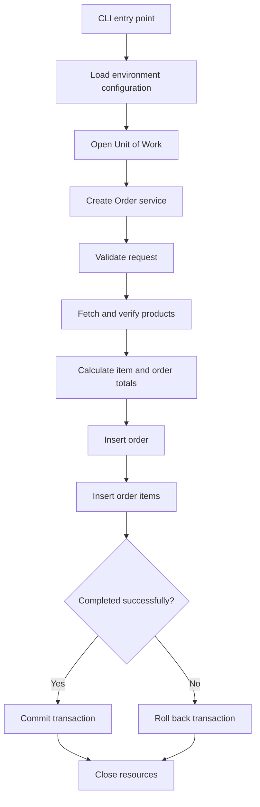

# E-commerce Order Processing Backend

A Python backend for creating and persisting e-commerce orders with PostgreSQL. The application validates incoming order data, retrieves authoritative product prices, calculates totals, and stores orders and their line items in a single database transaction.

**Interface:** Command-line entry point (no HTTP API or web interface in the current version).

**Documentation:** [Tiếng Việt](README_vi.md) | **English**

## Contents

- [Features](#features)
- [Technology Stack](#technology-stack)
- [Project Structure](#project-structure)
- [Architecture](#architecture)
- [Getting Started](#getting-started)
- [Verify a Created Order](#verify-a-created-order)
- [Run Tests](#run-tests)
- [Troubleshooting](#troubleshooting)
- [Security and Operational Notes](#security-and-operational-notes)

## Features

- Validates order requests, including product identifiers and positive integer quantities.
- Retrieves product records using parameterized PostgreSQL queries.
- Rejects requests containing nonexistent products.
- Uses database-managed product prices rather than client-provided prices.
- Calculates line-item subtotals and the total order amount.
- Stores order headers and line items in one transaction, with explicit commit and rollback behavior.
- Enforces referential integrity and uniqueness through database constraints.
- Includes automated unit tests and executable integration checks for success and failure scenarios.

## Technology Stack

| Component | Technology |
|---|---|
| Language | Python 3 |
| Database | PostgreSQL 16 |
| Database driver | `psycopg2` |
| Environment configuration | `python-dotenv` |
| Database hosting | Docker Compose |
| Testing | Python `unittest` and integration test scripts |

## Project Structure

```text
<repository-root>/
├── app/
│   ├── core/
│   │   ├── __init__.py
│   │   └── config.py               # Environment configuration validation
│   ├── db/
│   │   ├── __init__.py
│   │   ├── connection.py           # PostgreSQL connection creation
│   │   └── unit_of_work.py        # Transaction and resource management
│   ├── products/
│   │   ├── __init__.py
│   │   ├── repository.py           # Product queries
│   │   └── mapper.py               # Database row mapping
│   └── orders/
│       ├── __init__.py
│       ├── validators.py           # Request validation
│       ├── product_ids.py          # Unique product ID extraction
│       ├── product_checks.py       # Product existence checks
│       ├── pricing.py              # Item pricing and order totals
│       ├── repository.py           # Order and line-item persistence
│       └── service.py              # Order creation orchestration
├── database/
│   ├── migrations/
│   │   └── 001_initial_schema.sql  # Database tables and constraints
│   └── seeds/
│       └── products.sql            # Initial product data
├── scripts/
│   └── run_create_order.py         # Command-line entry point
├── tests/
│   ├── unit/
│   └── integration/
├── .env.example                    # Configuration template
├── .gitignore
├── compose.yml                     # PostgreSQL container definition
├── pyproject.toml
├── README.md                       #  English documentation
└── README_vi.md                    # Vietnamese documentation
```

## Architecture

### Order creation flow



The application separates configuration, database connectivity, data access, business operations, and transaction management. Repositories execute SQL using a cursor supplied by the caller; the Unit of Work manages transaction completion and connection cleanup.

### Database tables

| Table | Purpose | Key constraints |
|---|---|---|
| `products` | Product identifiers and prices | Primary key on `product_id` |
| `orders` | Order status and total amount | Primary key on `order_id`; default status `PENDING_PAYMENT` |
| `order_items` | Products, quantities, and prices for each order | Composite primary key on `(order_id, product_id)`; foreign keys to `orders` and `products` |

## Getting Started

### 1. Prerequisites

Install the following on your computer:

- Python 3 and `pip`
- Docker Desktop (or Docker Engine with the Docker Compose plugin)
- Git, if cloning the repository

The commands below target **Windows Command Prompt (CMD)** and should be run from the repository root, where `compose.yml` is located. For macOS/Linux, use the corresponding file-copy command and forward slashes in local file paths.

### 2. Install Python dependencies

Clone the repository or download its source archive, open a terminal in the project directory, and run:

```bat
python --version
python -m pip install psycopg2-binary python-dotenv
```

### 3. Configure environment variables

Create a local configuration file:

```bat
copy .env.example .env
```

Update `.env` with the following settings:

```dotenv
DB_HOST=127.0.0.1
DB_PORT=5432
DB_NAME=ecommerce
DB_USER=user
DB_PASSWORD=REPLACE_WITH_A_PRIVATE_PASSWORD
```

Replace the password placeholder with a password dedicated to this installation. Keep `.env` out of version control.

Docker Compose reads `DB_PASSWORD` and supplies it to PostgreSQL as `POSTGRES_PASSWORD`. The Python entry point uses `load_dotenv()` to read the same local configuration.

> **Existing installations:** Updating `.env` does not reset the password already stored in a previously initialized PostgreSQL data volume. See [Troubleshooting](#troubleshooting) if authentication fails.

### 4. Start PostgreSQL

```bat
docker compose up -d
docker compose ps
```

Wait until PostgreSQL is ready:

```bat
docker compose exec -T postgres pg_isready -U user -d ecommerce
```

Expected response:

```text
/var/run/postgresql:5432 - accepting connections
```

Port `5432` on your computer must be available. If another service uses it, see [Troubleshooting](#troubleshooting).

### 5. Create the database tables

Run the schema migration once on a newly initialized database:

```bat
docker compose exec -T postgres psql -v ON_ERROR_STOP=1 -U user -d ecommerce < database\migrations\001_initial_schema.sql
```

Expected output on first execution:

```text
CREATE TABLE
CREATE TABLE
CREATE TABLE
```

Check the tables:

```bat
docker compose exec -T postgres psql -U user -d ecommerce -c "\dt"
```

The database should contain `products`, `orders`, and `order_items`.

### 6. Load product data

```bat
docker compose exec -T postgres psql -v ON_ERROR_STOP=1 -U user -d ecommerce < database\seeds\products.sql
```

Expected output:

```text
INSERT 0 2
```

This inserts the following records:

| Product ID | Price |
|---|---:|
| `P101` | 100000 |
| `P102` | 50000 |

**Run the seed only once per new database.** Repeating it without removing the existing records causes a duplicate-primary-key error.

### 7. Create an order

Run the command-line application from the repository root:

```bat
python -m scripts.run_create_order
```

The entry point creates an order for two units of `P101` and three units of `P102`.

Expected output (abbreviated):

```text
ORDER_ID: ORD-UOW-REBUILD-001
RESULT: {'order_items': [...], 'amount': 350000}
```

On success, the transaction is committed and both the order and its items are persisted.

**To create another order**, update `order_id` in `scripts/run_create_order.py` to a new, unused identifier before rerunning the command. The current entry point uses a fixed order ID.

## Verify a Created Order

Confirm that the order was saved:

```bat
docker compose exec -T postgres psql -U user -d ecommerce -c "SELECT order_id, status, total_amount FROM orders WHERE order_id='ORD-UOW-REBUILD-001';"
```

Expected record:

| order_id | status | total_amount |
|---|---|---:|
| `ORD-UOW-REBUILD-001` | `PENDING_PAYMENT` | 350000 |

Check its line items:

```bat
docker compose exec -T postgres psql -U user -d ecommerce -c "SELECT product_id, quantity, unit_price FROM order_items WHERE order_id='ORD-UOW-REBUILD-001' ORDER BY product_id;"
```

Expected records:

| product_id | quantity | unit_price |
|---|---:|---:|
| `P101` | 2 | 100000 |
| `P102` | 3 | 50000 |

## Run Tests

### Unit tests

```bat
python -m unittest discover -s tests/unit -p "test_*.py" -v
```

### Integration tests

Ensure PostgreSQL is running and the migration and seed steps have completed, then run:

```bat
python -m tests.integration.test_uow_no_commit
python -m tests.integration.test_uow_failure
python -m tests.integration.test_invalid_product
python -m tests.integration.test_duplicate_order_item
```

| Test case | Expected result |
|---|---|
| No explicit commit | `ORDERS_COUNT: 0`, `ITEMS_COUNT: 0` |
| Error before commit | `EXPECTED_ERROR: SIMULATED_FAILURE`, both counts `0` |
| Unknown product | `EXPECTED_ERROR: product_id not found: P999`, both counts `0` |
| Duplicate line item | `EXPECTED_ERROR: order_items_pkey`, both counts `0` |

These integration checks are executable Python modules. The successful order creation scenario is run using `scripts.run_create_order` and verified with the SQL queries above.

## Troubleshooting

| Issue | Resolution |
|---|---|
| `DB_HOST is required` | Verify `.env` is present and the entry point calls `load_dotenv()`; run from the repository root. |
| `database "ecomerce" does not exist` | Correct the configuration to `DB_NAME=ecommerce`. |
| `password authentication failed` | Verify the database user's existing password. Changing `.env` alone does not update an existing database role. |
| Port `5432` already in use | Stop the conflicting service or change the host mapping in `compose.yml` to `5433:5432` and set `DB_PORT=5433`. |
| Duplicate order ID | Change `order_id` in `scripts/run_create_order.py` before rerunning. |
| Duplicate product ID during seed | Do not rerun the seed against records already inserted. |
| `No module named ...` | Check the file location and module path; execute commands from the repository root. |
| `NO TESTS RAN` | Verify `tests/unit/` contains files matching `test_*.py` with discoverable test methods. |

To update a PostgreSQL role password on an existing installation:

```bat
docker compose exec postgres psql -U user -d ecommerce
```

At the `psql` prompt, enter `\password user`, provide the new password when prompted, and update `.env` to match. Exit with `\q`.

### Stop the database

```bat
docker compose down
```

This removes the Compose-managed container and network but retains its named data volume. Use `docker compose up -d` to start it again with existing data.

**Avoid `docker compose down -v` unless you explicitly intend to delete the PostgreSQL data volume.**

## Security and Operational Notes

- Never commit `.env` or real credentials to Git. Keep only placeholder values in `.env.example`.
- Use a dedicated database and credentials for this installation.
- Product prices are sourced from PostgreSQL rather than client input.
- SQL queries use bound parameters rather than string interpolation.
- The current application provides a command-line order creation workflow; it does not expose a public HTTP endpoint, authentication layer, payment integration, or administration interface.
- The provided scripts and configuration are intended for a controlled, local environment. Additional hardening, operational monitoring, and deployment configuration would be required before any public-facing rollout.
