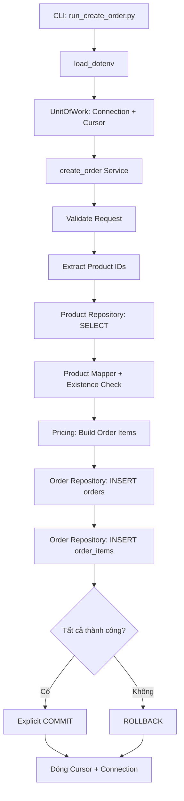

# E-commerce Order Processing Backend — PROJECT 1

**Create Order · PostgreSQL · Transaction Management · Production-oriented Project Structure**

PROJECT là dự án backend Python mô phỏng quy trình **tạo đơn hàng (Create Order)** cho hệ thống thương mại điện tử. Mục tiêu là minh họa cách tổ chức mã nguồn theo trách nhiệm, đọc và ghi dữ liệu bằng PostgreSQL, đồng thời bảo đảm tính nguyên tử (*atomicity*) của một giao dịch thông qua **Unit of Work (UoW)**.

> **Phạm vi:** Đây là dự án trình diễn kỹ thuật, **không phải hệ thống production-ready**. Phiên bản hiện tại chạy qua Python CLI và các integration tests; chưa cung cấp REST API, giao diện web, thanh toán thực tế hay cơ chế xác thực người dùng.

## Nội dung

- [1. Tính năng](#1-tính-năng)
- [2. Công nghệ](#2-công-nghệ)
- [3. Kiến trúc](#3-kiến-trúc)
- [4. Yêu cầu môi trường](#4-yêu-cầu-môi-trường)
- [5. Hướng dẫn cài đặt và chạy](#5-hướng-dẫn-cài-đặt-và-chạy)
- [6. Kiểm tra kết quả trong PostgreSQL](#6-kiểm-tra-kết-quả-trong-postgresql)
- [7. Chạy kiểm thử](#7-chạy-kiểm-thử)
- [8. Xử lý sự cố thường gặp](#8-xử-lý-sự-cố-thường-gặp)
- [9. Lưu ý bảo mật và dữ liệu](#9-lưu-ý-bảo-mật-và-dữ-liệu)
- [10. Giới hạn và hướng phát triển](#10-giới-hạn-và-hướng-phát-triển)

## 1. Tính năng

- Kiểm tra dữ liệu yêu cầu tạo đơn hàng: danh sách sản phẩm, `productId` và `quantity`.
- Truy vấn sản phẩm từ PostgreSQL bằng **parameterized SQL** (`psycopg2`).
- Kiểm tra các mã sản phẩm được yêu cầu có tồn tại hay không.
- Lấy đơn giá từ **database**, không tin cậy giá do phía client cung cấp.
- Tính `subtotal` từng dòng và `total_amount` của đơn hàng.
- Ghi `orders` và `order_items` trong **cùng một transaction**.
- Chỉ `COMMIT` sau khi toàn bộ nghiệp vụ thành công; `ROLLBACK` nếu gặp lỗi hoặc không chủ động commit.
- Kiểm thử các kịch bản: tạo đơn thành công, không commit, lỗi giữa transaction, sản phẩm không tồn tại và trùng sản phẩm trong cùng đơn.

### Dữ liệu demo

| Product ID | Đơn giá mẫu | Số lượng | Thành tiền |
|---|---:|---:|---:|
| `P101` | 100.000 | 2 | 200.000 |
| `P102` | 50.000 | 3 | 150.000 |
| **Tổng cộng** | | | **350.000** |

Các giá trị tiền trong PROJECT được lưu dưới dạng `INTEGER` (không sử dụng số thực).

## 2. Công nghệ

| Thành phần | Công nghệ |
|---|---|
| Ngôn ngữ | Python 3 |
| Database | PostgreSQL 16 |
| Database driver | `psycopg2` |
| Biến môi trường local | `python-dotenv` |
| Container | Docker / Docker Compose |
| Kiểm thử | Python `unittest` và integration scripts |

## 3. Kiến trúc

### Cấu trúc thư mục

```text
e_commerce_order_processing_backend/
├── app/
│   ├── core/
│   │   ├── __init__.py
│   │   └── config.py                 # Đọc và kiểm tra cấu hình
│   ├── db/
│   │   ├── __init__.py
│   │   ├── connection.py             # Tạo PostgreSQL connection
│   │   └── unit_of_work.py          # Transaction boundary
│   ├── products/
│   │   ├── __init__.py
│   │   ├── repository.py             # SELECT products
│   │   └── mapper.py                 # Tuple -> Dictionary
│   └── orders/
│       ├── __init__.py
│       ├── validators.py            # Validate request
│       ├── product_ids.py           # Trích xuất product IDs duy nhất
│       ├── product_checks.py        # Kiểm tra product tồn tại
│       ├── pricing.py               # Tính giá đơn hàng
│       ├── repository.py            # INSERT orders / order_items
│       └── service.py               # Orchestration CreateOrder
├── database/
│   ├── migrations/
│   │   └── 001_initial_schema.sql   # Tạo bảng và constraints
│   └── seeds/
│       └── products.sql             # Dữ liệu sản phẩm mẫu
├── scripts/
│   └── run_create_order.py          # Chạy demo CreateOrder
├── tests/
│   ├── unit/                       # Validation, product checks, ...
│   └── integration/                # UoW và các trường hợp lỗi
├── .env.example                    # Mẫu cấu hình (được phép commit)
├── .gitignore
├── compose.yml
├── pyproject.toml
└── README.md
```

### Luồng tạo đơn hàng



**Phân chia trách nhiệm:**

- **Configuration (`app/core`)**: đọc/validate biến môi trường.
- **Connection (`app/db/connection.py`)**: tạo và trả về connection; không commit.
- **Repository**: thực thi SQL với cursor từ bên ngoài; không tự mở connection hoặc commit.
- **Service**: điều phối các bước xử lý nghiệp vụ; không sở hữu transaction.
- **Unit of Work (`app/db/unit_of_work.py`)**: quản lý connection, cursor, commit, rollback và đóng tài nguyên. Thiết kế hiện tại dùng **explicit commit**.

**Database schema:**

| Bảng | Nội dung | Ràng buộc chính |
|---|---|---|
| `products` | Danh mục sản phẩm, đơn giá | PK `product_id` |
| `orders` | Đơn hàng, trạng thái, tổng tiền | PK `order_id`; mặc định `PENDING_PAYMENT` |
| `order_items` | Sản phẩm thuộc đơn hàng | PK `(order_id, product_id)`; FK đến `orders` và `products` |

## 4. Yêu cầu môi trường

Trước khi bắt đầu, cần có:

1. **Python 3** và `pip` (có thể chạy `python --version`).
2. **Docker Desktop** hoặc Docker Engine + Compose plugin (có thể chạy `docker compose version`).
3. Terminal tại **thư mục gốc dự án**, nơi chứa `compose.yml`.
4. Host port **5432** đang trống; nếu đã bị sử dụng, xem mục [Xử lý sự cố](#8-xử-lý-sự-cố-thường-gặp).

> Các ví dụ bên dưới ưu tiên **Windows Command Prompt (CMD)**. Với macOS/Linux, thay dấu `\` trong đường dẫn file bằng `/` khi cần.

## 5. Hướng dẫn cài đặt và chạy

### Bước 1 — Lấy mã nguồn và cài Python dependencies

Clone repository trên GitHub hoặc tải source code dưới dạng ZIP, sau đó mở CMD tại thư mục gốc dự án.

```bat
python --version
python -m pip install psycopg2-binary python-dotenv
```

`psycopg2-binary` phù hợp để thiết lập PROJECT nhanh; khi triển khai thực tế, cần chọn và quản lý bản build/dependency phù hợp với môi trường production.

### Bước 2 — Tạo file cấu hình `.env`

```bat
copy .env.example .env
```

Mở `.env`, chỉnh thành các biến tương ứng:

```dotenv
DB_HOST=127.0.0.1
DB_PORT=5432
DB_NAME=ecommerce
DB_USER=user
DB_PASSWORD=REPLACE_WITH_YOUR_LOCAL_PASSWORD
```

**Bắt buộc thay** `REPLACE_WITH_YOUR_LOCAL_PASSWORD` bằng mật khẩu riêng chỉ dành cho PROJECT. Đảm bảo `DB_NAME` viết đúng là **`ecommerce`**.

- Docker Compose dùng `${DB_PASSWORD}` trong `compose.yml` để truyền cho biến `POSTGRES_PASSWORD` của PostgreSQL container.
- Python entry script gọi `load_dotenv()` để nạp các biến này trước khi kết nối.
- **Không commit `.env` lên Git**. Chỉ commit `.env.example` với giá trị mẫu, không chứa secrets.

### Bước 3 — Khởi động PostgreSQL

```bat
docker compose up -d
docker compose ps
```

Kiểm tra PostgreSQL đã sẵn sàng:

```bat
docker exec ecommerce_lab1_db pg_isready -U user -d ecommerce
```

Kết quả dự kiến:

```text
/var/run/postgresql:5432 - accepting connections
```

### Bước 4 — Tạo schema (migration)

Trong **Windows CMD**, chạy:

```bat
docker exec -i ecommerce_lab1_db psql -v ON_ERROR_STOP=1 -U user -d ecommerce < database\migrations\001_initial_schema.sql
```

Khi database còn mới, kết quả dự kiến:

```text
CREATE TABLE
CREATE TABLE
CREATE TABLE
```

Kiểm tra các bảng:

```bat
docker exec ecommerce_lab1_db psql -U user -d ecommerce -c "\dt"
```

Phải có ba bảng: `products`, `orders`, `order_items`.

### Bước 5 — Nạp dữ liệu mẫu (seed)

```bat
docker exec -i ecommerce_lab1_db psql -v ON_ERROR_STOP=1 -U user -d ecommerce < database\seeds\products.sql
```

Kết quả dự kiến khi nạp lần đầu:

```text
INSERT 0 2
```

Kiểm tra:

```bat
docker exec ecommerce_lab1_db psql -U user -d ecommerce -c "SELECT product_id, product_cost FROM products ORDER BY product_id;"
```

Bạn sẽ thấy `P101 = 100000` và `P102 = 50000`.

> **Chú ý:** File seed hiện tại là `INSERT` thông thường, không tự xử lý trùng khóa. **Chỉ chạy một lần trên database mới**; chạy lại sẽ báo lỗi duplicate primary key.

### Bước 6 — Chạy demo CreateOrder

Chạy từ **thư mục gốc** bằng Python module syntax:

```bat
python -m scripts.run_create_order
```

Script sử dụng Order ID demo `ORD-UOW-REBUILD-001`, với P101 × 2 và P102 × 3.

Kết quả mẫu (rút gọn):

```text
ORDER_ID: ORD-UOW-REBUILD-001
RESULT: {'order_items': [...], 'amount': 350000}
```

Khi thành công, UoW gọi `commit()` và lưu Order cùng hai Order Items.

> **Chạy lại demo:** `order_id` là Primary Key. Muốn chạy thêm lần nữa, hãy đổi `order_id` trong `scripts/run_create_order.py` thành **một ID chưa tồn tại**, ví dụ `ORD-UOW-REBUILD-002`. Không cần xóa database.

## 6. Kiểm tra kết quả trong PostgreSQL

Kiểm tra Order:

```bat
docker exec ecommerce_lab1_db psql -U user -d ecommerce -c "SELECT order_id, status, total_amount FROM orders WHERE order_id='ORD-UOW-REBUILD-001';"
```

Kết quả mong đợi:

| order_id | status | total_amount |
|---|---|---:|
| ORD-UOW-REBUILD-001 | PENDING_PAYMENT | 350000 |

Kiểm tra Order Items:

```bat
docker exec ecommerce_lab1_db psql -U user -d ecommerce -c "SELECT order_id, product_id, quantity, unit_price FROM order_items WHERE order_id='ORD-UOW-REBUILD-001' ORDER BY product_id;"
```

Kết quả mong đợi:

| product_id | quantity | unit_price |
|---|---:|---:|
| P101 | 2 | 100000 |
| P102 | 3 | 50000 |

## 7. Chạy kiểm thử

### Unit Tests

Chạy các file `unittest` trong `tests/unit`:

```bat
python -m unittest discover -s tests/unit -p "test_*.py" -v
```

Các bài kiểm tra đã xây dựng trong PROJECT gồm validation và product existence check. Các test thuần Python không cần PostgreSQL.

### Integration Tests

Cần PostgreSQL đang chạy, schema và seed đã được thiết lập, và `.env` hợp lệ.

```bat
python -m tests.integration.test_uow_no_commit
python -m tests.integration.test_uow_failure
python -m tests.integration.test_invalid_product
python -m tests.integration.test_duplicate_order_item
```

Các kết quả mong đợi:

| Kịch bản | Kết quả chính |
|---|---|
| **No Commit** | `AMOUNT: 350000`, `ORDERS_COUNT: 0`, `ITEMS_COUNT: 0` |
| **Failure Injection** | `EXPECTED_ERROR: SIMULATED_FAILURE`, cả hai COUNT bằng `0` |
| **Invalid Product** | `EXPECTED_ERROR: product_id not found: P999`, cả hai COUNT bằng `0` |
| **Duplicate Order Item** | `EXPECTED_ERROR: order_items_pkey`, cả hai COUNT bằng `0` |

**Happy Path / COMMIT** được chạy qua `python -m scripts.run_create_order` và xác minh bằng hai câu SELECT trong mục 6.

Các bài integration trên là **script kiểm thử tích hợp**; chạy trực tiếp bằng `python -m`, không giả định tất cả đều là test case của `unittest discover`.

## 8. Xử lý sự cố thường gặp

| Hiện tượng | Nguyên nhân thường gặp | Cách xử lý |
|---|---|---|
| `DB_HOST is required` | Python chưa nạp biến môi trường | Kiểm tra file `.env` và `load_dotenv()` ở entry script; chạy từ Project Root |
| `database "ecomerce" does not exist` | Gõ nhầm `DB_NAME` | Sửa thành `DB_NAME=ecommerce` |
| `password authentication failed` | Mật khẩu Python không khớp role PostgreSQL | Kiểm tra cấu hình; nếu database đã khởi tạo, đổi `.env` **không tự đổi mật khẩu PostgreSQL** |
| `port is already allocated` | Host port `5432` đang được sử dụng | Dừng dịch vụ/container đang chiếm cổng hoặc đổi mapping sang `5433:5432` và `DB_PORT=5433` |
| `duplicate key value violates unique constraint "orders_pkey"` | Chạy lại demo với cùng `order_id` | Chọn một `order_id` mới |
| `duplicate key ... products_pkey` | Chạy lại seed sản phẩm | Không seed lại dữ liệu đã tồn tại |
| `No module named scripts...` | Đường dẫn module/file không đúng | Chạy từ Project Root; kiểm tra tên file và dùng `python -m` đúng package |
| `NO TESTS RAN` | Test đặt sai folder hoặc không được `unittest` nhận diện | Kiểm tra `tests/unit/`, tên `test_*.py` và các method `test_*` |

**Nếu cần đổi password của PostgreSQL đã khởi tạo:** có thể vào `psql` bằng `docker exec -it ecommerce_lab1_db psql -U user -d ecommerce`, sau đó dùng lệnh `\password user` và làm theo hướng dẫn nhập kín trên terminal. Đồng bộ lại `.env` sau đó.

### Dừng môi trường

```bat
docker compose down
```

Lệnh trên dừng/xóa container và network do Compose quản lý, nhưng **giữ named volume**. Chạy lại `docker compose up -d` để sử dụng dữ liệu đã có.

**Không dùng `docker compose down -v`** nếu không chủ động muốn xóa volume và dữ liệu PostgreSQL của PROJECT.

## 9. Lưu ý bảo mật và dữ liệu

- `.env` chứa thông tin kết nối và **không được đưa lên Git**; kiểm tra `.gitignore` và `git status` trước khi push.
- Không sử dụng mật khẩu thật của hệ thống khác cho môi trường demo.
- Đừng in password vào logs, commit vào mã nguồn hoặc chụp ảnh chứa mật khẩu.
- `get_env()` thực hiện validation cấu hình; `get_connection()` chỉ mở connection; repository dùng parameterized query thay vì ghép SQL với input.
- Đơn giá được lấy từ PostgreSQL để tránh việc client tự quyết định giá.
- Chạy các bài test trên **database riêng cho PROJECT**, không dùng database chứa dữ liệu khách hàng thật.

## 10. Giới hạn và hướng phát triển

Phiên bản này đã chứng minh luồng **CreateOrder + Transaction Boundary** qua các kịch bản kiểm thử chính, nhưng chưa bao gồm:

- HTTP REST API / OpenAPI và giao diện người dùng.
- Authentication, authorization, multi-tenant isolation.
- Tích hợp thanh toán, kho hàng, vận chuyển hoặc xử lý bất đồng bộ.
- Migration versioning tự động và cấu hình deploy production.
- Xử lý tất cả các edge cases nghiệp vụ như chính sách gộp sản phẩm trùng trong cùng đơn; phiên bản hiện tại dựa vào composite primary key để từ chối trường hợp này.

Dự án phù hợp để **review kiến trúc, chạy demo và mở rộng thành backend hoàn chỉnh trong các PROJECT tiếp theo**.

---

**Phạm vi kiểm chứng:** Luồng chạy và các ví dụ trong tài liệu dựa trên cấu trúc và kịch bản PROJECT 1 đã triển khai. Khi thay đổi tên file, service, thông số Docker hoặc schema, hãy cập nhật README tương ứng để tài liệu tiếp tục khớp mã nguồn.
